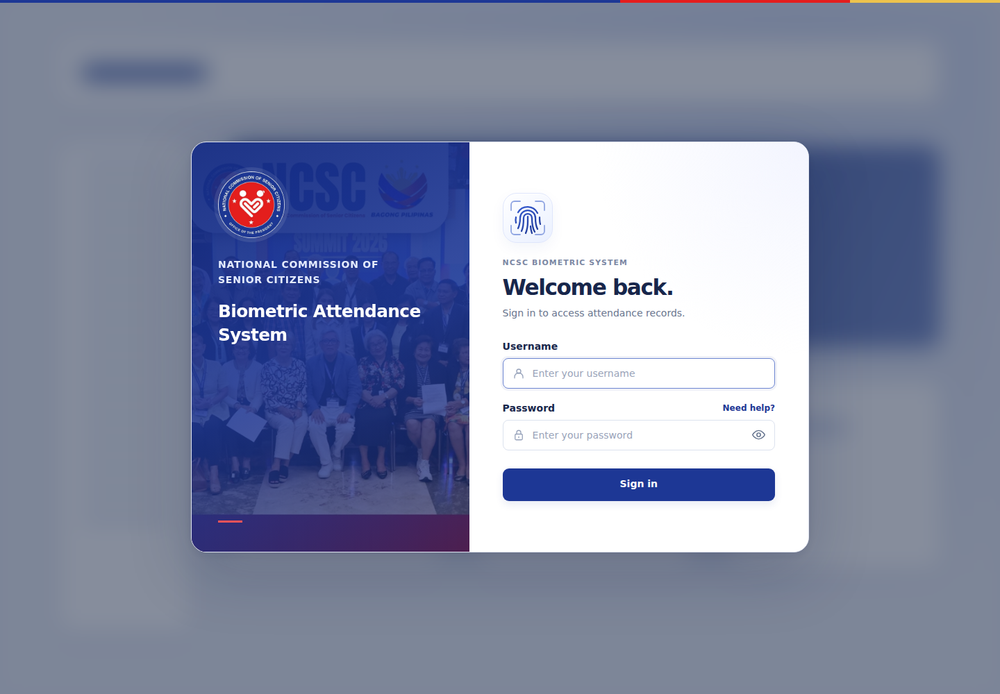

# NCSC Biometric Attendance System

Local **DTR monitoring workspace** for ZKTeco K14 scans and existing **AJA / Fieldwork / Official Business / Travel Order** references. Office approvals stay in the existing office process; employees do not file the same request again here.

> **Internal pilot only.** No real employee records, fingerprint templates, credentials, or database files are included in this public repository. Do not expose the local server to the public internet or use it as an official payroll/DTR source without review and authorization.

## What's included

- Modern responsive web UI (Overview, DTR Monitoring, Attendance Logs, USB Imports, Staff & Work Codes, Activity References)
- FastAPI backend and local SQLite database
- Admin sign-in with scrypt password hashing, signed session cookie, and CSRF protection
- USB attendance log **preview** and import
- Duplicate-safe original scan events and recorded import batches
- Optional references to existing office activities, saved directly without a second approval; audited void/correction history
- Raw K14 device status/verification/work codes preserved **without guessing IN or OUT**
- Staff database keyed by device employee ID, populated automatically from scans and enriched with names from the K14 .xls report or a CSV roster
- Per-device work-code labels and activity types, left unclassified until mapped to the actual device configuration
- A future LAN-sync adapter can be added without changing the database's record model
- NCSC blue, red, and white theme with the supplied seal and locally served NCSC photography
- Direct sign-in page with NCSC photography, a fingerprint emblem, password visibility control, and inline login errors
- Daily scan chart, date filters, paginated source logs, and reference history filters
- Monthly monitoring by employee: original scan times beside existing AJA and travel references; empty days are not labeled absent
- Previous pending/approved/rejected entries are retained as history and are not silently converted into office approvals
- Read-only **K14 .xls report preview**, kept separate from raw attendance imports

## Interface previews

The dashboard screenshot uses explicitly fictional sample records.



The updated dashboard and daily monitoring previews are generated by the browser check in GitHub Actions (`ncsc-design-previews` artifact).

[View the mobile sign-in layout](docs/mobile-login-preview.webp).

## Tech stack

- **Python 3.11+**, FastAPI, Uvicorn, SQLite (no separate database server needed)
- Plain HTML, CSS and JavaScript (no Node.js build needed)
- Cursor or VS Code, Windows-friendly

## Quick start in Cursor (Windows PowerShell)

### 1. Clone and open the project

```powershell
cd "$HOME\Documents"
git clone https://github.com/Yelsxii/NCSC_Biometric-System.git
cd NCSC_Biometric-System
git checkout feat/ncsc-theme
cursor .
```

> If Cursor is already open, use **File → Open Folder** and select `NCSC_Biometric-System`. If the `cursor` terminal command is unavailable, use that menu instead.

### 2. Create a virtual environment and install dependencies

```powershell
py -3 -m venv .venv
.\.venv\Scripts\python.exe -m pip install -r requirements.txt
```

### 3. Configure your local secret

```powershell
Copy-Item .env.example .env
.\.venv\Scripts\python.exe -c "import secrets; print(secrets.token_urlsafe(48))"
notepad .env
```

Replace `CHANGE_ME_TO_A_LONG_RANDOM_VALUE` with the freshly generated random string. Keep `.env` out of GitHub.

### 4. Create a local admin account

```powershell
.\.venv\Scripts\python.exe -m app.cli create-admin
```

Choose a private username and a strong password of 12+ characters. These are stored only as a salted password hash.

### 5. Run the web application

```powershell
.\.venv\Scripts\python.exe -m uvicorn app.main:app --host 127.0.0.1 --port 8000 --reload
```

Open **http://127.0.0.1:8000** in your browser and sign in.

The sign-in page opens directly. Enter your existing office account to access attendance records. Existing accounts and source scans are retained. Startup adds the activity reference table automatically; previous activity requests remain available as read-only history.

Press **Ctrl+C** to stop. The SQLite database is created at `data/ncsc.sqlite3`, which is ignored by Git.

## USB import workflow

1. On an authorized ZKTeco K14: **USB Manager / Download → Attendance Data → This Month** (menu labels vary).
2. Keep the original `*_attlog.dat` file in a secure office folder. **Do not upload it to GitHub.**
3. Inside the application: **USB Imports → Choose file → Preview file**.
4. Review the count, date range, unique employee IDs, and raw status codes.
5. Select **Import records**. The system stores the source events separately and skips duplicate events.
6. Visit **Attendance Logs** to review records.

Select an exact employee ID and/or inclusive From/To dates to filter scans. Use **Previous** and **Next** to browse more than 25 results. The overview chart shows seven calendar days ending on the latest imported scan date, including zero-count days. It counts device events only.

### Excel device reports

USB imports also previews legacy **.xls** K14 reports containing an `Att.log report` worksheet. The preview shows the reporting period, unique device IDs, and worksheet structure. This attendance preview does not save report contents, infer IN/OUT events, or import calculated attendance/OT totals. Select **Import staff names from this report** to preview and save the ID/name/department roster separately. Use the original `_attlog.dat` for source scan ingestion. Other workbook layouts and `.xlsx` are not supported by this preview.

### Supported K14 six-field log format

```text
EMP001<TAB>2026-11-03 07:21:07<TAB>1<TAB>0<TAB>1<TAB>0
```

Fields: employee ID, scan timestamp, device ID, **raw status code**, **raw verification code**, raw work code. Field meaning should be confirmed with the exact firmware/device configuration before classifying any scan as IN/OUT. The example uses a **fictional** ID.

## Staff database and device work codes

The biometric device remains where staff enroll. Staff here are attendance identities, separate from administrator/reviewer login accounts. Importing attendance automatically registers its employee IDs and observed `(device_id, work_code)` pairs. It does not invent names or meanings; code `0` is not automatically treated as Regular or AJA.

1. **Staff & work codes → Import staff names**: choose the device's `.xls` report with the `Att.log report` worksheet, preview the roster, then select **Import names**. This reads only ID, name and department headers. It does not import biometrics, passwords, card data or calculated attendance totals.
2. Alternatively, use a UTF-8 CSV with headers `employee_code,display_name,department`; the department column may be omitted. Keep IDs as text to preserve leading zeroes. The roster may include staff with no scans yet.
3. Roster import creates staff or fills missing names/departments. It never overwrites conflicting existing details. Check conflicts and use **Edit** to correct the staff metadata deliberately. Reimporting a roster does not duplicate staff.
4. In **Device work codes**, map each observed code to the actual device label and activity type. The mapping applies only to that device ID. You may also add a code from the device's existing list before it appears in a scan.
5. Attendance logs and DTR monitoring display the linked staff name and work-code label while retaining the original device IDs, codes and timestamps.

Binary `user.dat` backups and binary Work Code exports have firmware-dependent layouts and are not supported by this importer. No device write, re-enrollment or live LAN download is implemented. Use the readable report for names and the actual device list to verify code labels.

### If import or attendance looks empty

- Use **USB imports** for the original `_attlog.dat` / `.txt` attendance export. The `.xls` report supplies staff names through the separate roster import; it does not supply exact raw scan events.
- Select **Preview file**, then **Import records**, then **View imported attendance**. That last button resets old attendance filters.
- Same-file reimport is intentionally blocked. A successful roster import adds names, not attendance scans.
- Invalid-file and server errors stay below the import form until the next attempt. Record that exact error if the problem persists.
- Pull the latest branch, restart Uvicorn, and press Ctrl+F5 if the browser or server is still running an earlier version. Keep the app at `http://127.0.0.1:8000` rather than opening `index.html` directly.

## DTR monitoring workflow

1. Import the original USB attendance log. In the future, the LAN adapter will feed the same source records.
2. Open **DTR monitoring**, choose the device employee ID and month, and view the daily scan times alongside existing activity references.
3. Compare these records with the office DTR. The system does not infer AM/PM slots from unverified device codes, turn a blank day into absence, or add its own lunch, overtime or undertime rules.
4. AJA and travel orders continue through the existing office process. **Activity references** is optional: record an existing order number or short DTR note only when needed for monitoring. No employee application, pending queue or approval/rejection is required.
5. If a reference is incorrect, use **Void reference** with a reason, then save the corrected reference. Both remain in history; source scans are never changed.

An activity's start/end is its reference coverage, **not a calculation of credited working hours**. A whole-day travel order does not become 24 working hours. An activity that ends at midnight does not cover the next day. Overlapping references are displayed independently, without adding them to scan durations.

Previous activity requests remain under **Previous system entries** with their original statuses. They do not enter the new monitoring references automatically. Old write/decision endpoints return HTTP 410 so outdated clients cannot continue the retired approval workflow. Existing read access remains available.

Current monitoring is an evidence view, not an automatically completed or exportable official DTR. The NCSC AM/PM DTR, its verified entries and its existing calculations are the reference for the next DTR output stage. No new lunch policy is introduced by this revision. See [monitoring workflow](docs/monitoring-workflow.md).

## Data and safety rules

- Never alter the biometric device's historical attendance records. This application has **no K14 write functions**.
- No fingerprint templates or biometric images are downloaded or stored.
- Never commit `.env`, `data/`, `uploads/`, or attendance `.dat` exports.
- Only authorized HR personnel should access real employee data, even during testing.
- Uploads are validated (up to 2 MB, 50,000 lines) and the parser reads data as text, not code.
- Date/time fields represent **office local time (Asia/Manila)**; no timezone conversion is applied to K14 local device timestamps.
- Scan status codes `0`, `1`, `4` **are not automatically treated as time-in or time-out**.
- Activity references are independent of biometric events and cannot overwrite scans.
- Same-file reimport is blocked; duplicate attendance event keys are ignored.
- SQLite backups should be encrypted and access-controlled. Avoid saving unencrypted exports in shared folders.

## Pilot limitations and next development stages

1. **Live device metadata:** staff IDs, roster imports and work-code mapping are implemented locally. Read-only automatic retrieval of enrolled staff and work-code definitions still requires verified device connectivity and a compatible connector.
2. **Existing activity records:** add a source import/connector for the current office register if available, so staff do not re-encode already recorded AJA or orders. Manual references remain optional.
3. **NCSC DTR output:** match verified AM/PM scan meanings, existing DTR formulas and the exact printable template before implementing automated filling, undertime or export. Do not add independent lunch deductions or new attendance policy.
4. **Network sync adapter:** when authorized, verify actual Ethernet connectivity, K14 SDK/protocol, and a **read-only** pull path. The existing import/punch schema is designed for both USB and future LAN sources.
5. **Operational hardening:** HTTPS, secrets management, account management, rate-limiting/login lockout, roles and permissions, automated backups, retention policy, and security review before office-wide rollout.

This is deliberately **not** a certified payroll or official biometric attendance platform yet.

## Project structure

```text
NCSC_Biometric-System/
├── app/
│   ├── __init__.py
│   ├── cli.py              # create-admin command
│   ├── db.py               # SQLite schema and persistence
│   ├── security.py         # salted password hashing
│   ├── parser.py           # validated raw K14 attendance file parsing
│   ├── main.py             # authenticated API and application
│   ├── index.html          # responsive dashboard layout
│   └── static/
│       ├── app.css         # design system, layout and responsiveness
│       └── app.js          # API-driven UI interactions
├── tests/
│   └── test_app.py
├── .github/workflows/
│   └── test.yml
├── .env.example
├── .gitignore
├── requirements.txt
└── README.md
```

## Run tests

```powershell
.\.venv\Scripts\python.exe -m pip install pytest httpx
.\.venv\Scripts\python.exe -m pytest -q
```

GitHub Actions also runs an isolated Chromium smoke check for direct sign-in, session restore/logout, raw-log preview/import/deduplication, Excel report preview, filtering, persistent import errors, staff roster import, work-code mapping, linked names, activity references and audited corrections, daily monitoring, and 1440/768/390/320px layouts. Its `ncsc-design-previews` artifact contains screenshots with fictional data only.

Optional local browser check (Node.js is needed only for this check):

```powershell
npm install --no-save --package-lock=false playwright@1.62.1
npx playwright install chromium
node tests/browser_smoke.cjs
```

The browser check creates an isolated temporary database and account, then removes them. It never uses the office database or uploaded reports. See [asset sources](app/static/images/SOURCES.md) for the bundled logo and photograph.

## Working with GitHub

The current revision lives in `feat/ncsc-theme`, with PR #2 targeting `feat/phase1-usb-attendance`. GitHub updates do not automatically update a Windows checkout. From your project folder, run:

```powershell
git switch feat/ncsc-theme
git pull --ff-only origin feat/ncsc-theme
```

Restart the local server if it is not using `--reload`, then refresh the browser with **Ctrl+F5**.

If you merge the PR first, clone `main` without checking out the feature branch.

---
**Maintained for the NCSC biometric integration pilot.**
