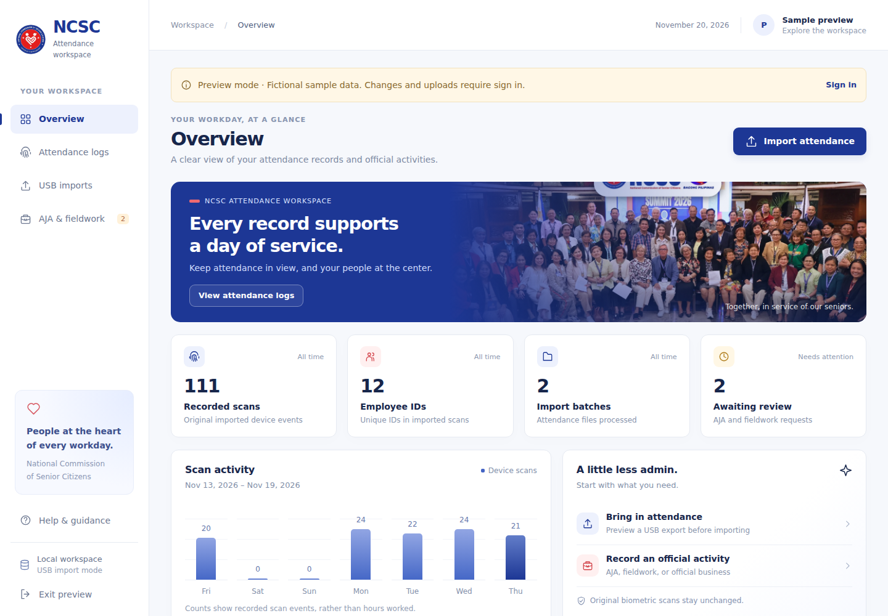

# NCSC Biometric Attendance System

Local-first, security-conscious **Phase 1 MVP** for importing ZKTeco K14 attendance data and recording separate **AJA / Fieldwork / Official Business** entries.

> **Internal pilot only.** No real employee records, fingerprint templates, credentials, or database files are included in this public repository. Do not expose the local server to the public internet or use it as an official payroll/DTR source without review and authorization.

## What's included

- Modern responsive web UI (Overview, Attendance Logs, USB Imports, AJA / Fieldwork)
- FastAPI backend and local SQLite database
- Admin sign-in with scrypt password hashing, signed session cookie, and CSRF protection
- USB attendance log **preview** and import
- Duplicate-safe original scan events and recorded import batches
- Separate fieldwork entries with pending/approved/rejected decisions and an audit trail
- Raw K14 device status/verification/work codes preserved **without guessing IN or OUT**
- A future LAN-sync adapter can be added without changing the database's record model
- NCSC blue, red, and white theme with the supplied seal and locally served NCSC photography
- Direct sign-in page with NCSC photography, a fingerprint emblem, password visibility control, and inline login errors
- Daily scan chart, date filters, paginated source logs, and activity status filters
- Read-only **K14 .xls report preview**, kept separate from raw attendance imports

## Interface previews

The dashboard screenshot uses explicitly fictional sample records.




[View the mobile sign-in layout](docs/mobile-login-preview.webp).

## Tech stack

- **Python 3.11+**, FastAPI, Uvicorn, SQLite (no separate database server needed)
- Plain HTML, CSS and JavaScript (no Node.js build needed)
- Cursor or VS Code, Windows-friendly

## Quick start in Cursor (Windows PowerShell)

### 1. Clone and open the project

```powershell
cd "$HOME\Documents"
git clone https://github.com/Yelsxii/NCSC_Biometric-System.git
cd NCSC_Biometric-System
git checkout feat/phase1-usb-attendance
cursor .
```

> If Cursor is already open, use **File → Open Folder** and select `NCSC_Biometric-System`. If the `cursor` terminal command is unavailable, use that menu instead.

### 2. Create a virtual environment and install dependencies

```powershell
py -3 -m venv .venv
.\.venv\Scripts\python.exe -m pip install -r requirements.txt
```

### 3. Configure your local secret

```powershell
Copy-Item .env.example .env
.\.venv\Scripts\python.exe -c "import secrets; print(secrets.token_urlsafe(48))"
notepad .env
```

Replace `CHANGE_ME_TO_A_LONG_RANDOM_VALUE` with the freshly generated random string. Keep `.env` out of GitHub.

### 4. Create a local admin account

```powershell
.\.venv\Scripts\python.exe -m app.cli create-admin
```

Choose a private username and a strong password of 12+ characters. These are stored only as a salted password hash.

### 5. Run the web application

```powershell
.\.venv\Scripts\python.exe -m uvicorn app.main:app --host 127.0.0.1 --port 8000 --reload
```

Open **http://127.0.0.1:8000** in your browser and sign in.

The sign-in page opens directly. Enter your existing office account to access attendance records. Existing accounts and attendance data need no migration for this interface update.

Press **Ctrl+C** to stop. The SQLite database is created at `data/ncsc.sqlite3`, which is ignored by Git.

## USB import workflow

1. On an authorized ZKTeco K14: **USB Manager / Download → Attendance Data → This Month** (menu labels vary).
2. Keep the original `*_attlog.dat` file in a secure office folder. **Do not upload it to GitHub.**
3. Inside the application: **USB Imports → Choose file → Preview file**.
4. Review the count, date range, unique employee IDs, and raw status codes.
5. Select **Import records**. The system stores the source events separately and skips duplicate events.
6. Visit **Attendance Logs** to review records.

Select an exact employee ID and/or inclusive From/To dates to filter scans. Use **Previous** and **Next** to browse more than 25 results. The overview chart shows seven calendar days ending on the latest imported scan date, including zero-count days. It counts device events only.

### Excel device reports

USB imports also previews legacy **.xls** K14 reports containing an `Att.log report` worksheet. The preview shows the reporting period, unique device IDs, and worksheet structure. It does not save report contents, infer IN/OUT events, or import calculated attendance/OT totals. Use the original `_attlog.dat` for source scan ingestion. Other workbook layouts and `.xlsx` are not supported by this preview.

### Supported K14 six-field log format

```text
EMP001<TAB>2026-11-03 07:21:07<TAB>1<TAB>0<TAB>1<TAB>0
```

Fields: employee ID, scan timestamp, device ID, **raw status code**, **raw verification code**, raw work code. Field meaning should be confirmed with the exact firmware/device configuration before classifying any scan as IN/OUT. The example uses a **fictional** ID.

## Data and safety rules

- Never alter the biometric device's historical attendance records. This application has **no K14 write functions**.
- No fingerprint templates or biometric images are downloaded or stored.
- Never commit `.env`, `data/`, `uploads/`, or attendance `.dat` exports.
- Only authorized HR personnel should access real employee data, even during testing.
- Uploads are validated (up to 2 MB, 50,000 lines) and the parser reads data as text, not code.
- Date/time fields represent **office local time (Asia/Manila)**; no timezone conversion is applied to K14 local device timestamps.
- Scan status codes `0`, `1`, `4` **are not automatically treated as time-in or time-out**.
- Fieldwork entries are independent of biometric events and cannot overwrite scans.
- Same-file reimport is blocked; duplicate attendance event keys are ignored.
- SQLite backups should be encrypted and access-controlled. Avoid saving unencrypted exports in shared folders.

## Pilot limitations and next development stages

1. **Employee registry and mapping:** manage verified staff ↔ K14 ID mapping. Currently IDs appear as exported.
2. **Separate requester/reviewer roles:** the pilot is admin-entered; a production approval flow must enforce distinct approver and requester identities and explicit policy.
3. **Validated DTR interpretation:** confirm actual firmware status codes, shift rules, breaks, exceptions, and audit requirements with HR before computing time-in/out or payable hours.
4. **Network sync adapter:** when authorized, verify actual Ethernet connectivity, K14 SDK/protocol, and a **read-only** pull path. The existing import/punch schema is designed for both USB and future LAN sources.
5. **Operational hardening:** HTTPS, secrets management, account management, rate-limiting/login lockout, roles and permissions, automated backups, retention policy, and security review before office-wide rollout.

This is deliberately **not** a certified payroll or official biometric attendance platform yet.

## Project structure

```text
NCSC_Biometric-System/
├── app/
│   ├── __init__.py
│   ├── cli.py              # create-admin command
│   ├── db.py               # SQLite schema and persistence
│   ├── security.py         # salted password hashing
│   ├── parser.py           # validated raw K14 attendance file parsing
│   ├── main.py             # authenticated API and application
│   ├── index.html          # responsive dashboard layout
│   └── static/
│       ├── app.css         # design system, layout and responsiveness
│       └── app.js          # API-driven UI interactions
├── tests/
│   └── test_app.py
├── .github/workflows/
│   └── test.yml
├── .env.example
├── .gitignore
├── requirements.txt
└── README.md
```

## Run tests

```powershell
.\.venv\Scripts\python.exe -m pip install pytest httpx
.\.venv\Scripts\python.exe -m pytest -q
```

GitHub Actions also runs an isolated Chromium smoke check for direct sign-in, session restore/logout, raw-log preview/import/deduplication, Excel report preview, filtering, fieldwork decisions, and 1440/768/390/320px layouts. Its `ncsc-design-previews` artifact contains screenshots with fictional data only.

Optional local browser check (Node.js is needed only for this check):

```powershell
npm install --no-save --package-lock=false playwright@1.62.1
npx playwright install chromium
node tests/browser_smoke.cjs
```

The browser check creates an isolated temporary database and account, then removes them. It never uses the office database or uploaded reports. See [asset sources](app/static/images/SOURCES.md) for the bundled logo and photograph.

## Working with GitHub

This starter implementation lives in `feat/phase1-usb-attendance` for review before merging to `main`. Open a pull request, review/test it, then merge after verification.

If you merge the PR first, clone `main` without checking out the feature branch.

---
**Maintained for the NCSC biometric integration pilot.**
